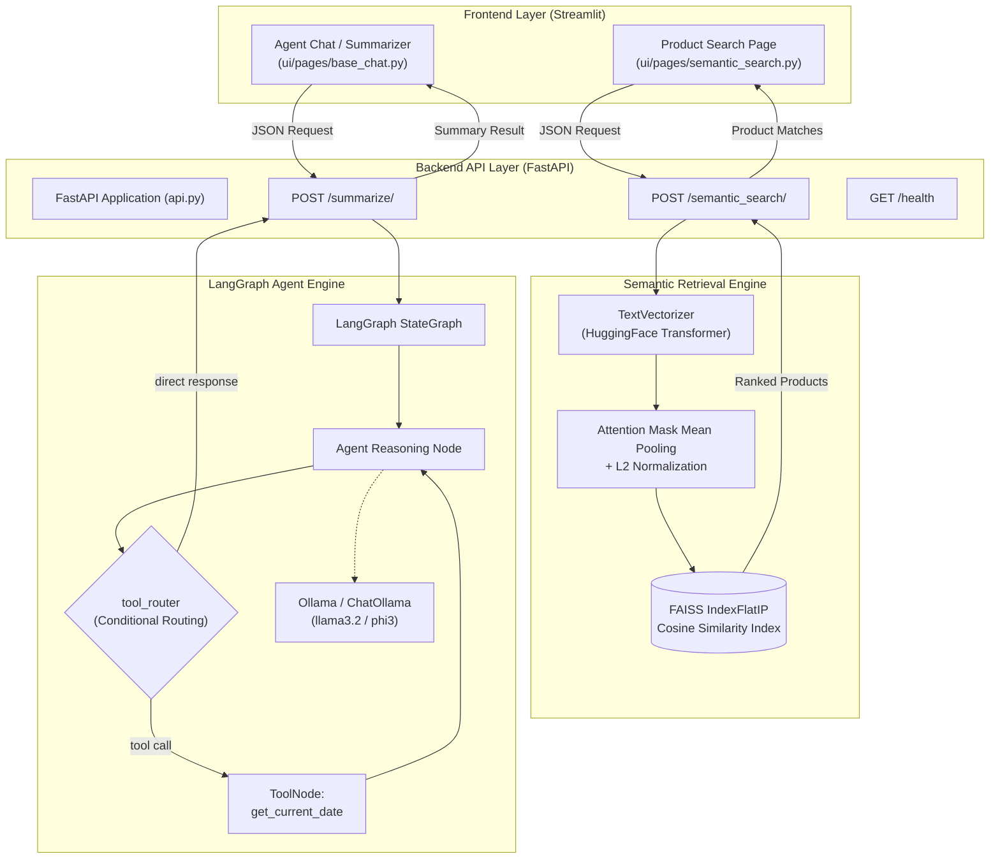

# Semantic Product Discovery & Autonomous Summarization Agent

[](https://www.python.org/)
[](https://fastapi.tiangolo.com)
[](https://github.com/langchain-ai/langgraph)
[](https://github.com/facebookresearch/faiss)
[](https://pytorch.org/)
[](https://streamlit.io)
[](https://python-poetry.org/)
[](https://www.docker.com/)

A practical AI engineering application combining **dense vector retrieval** across product catalog data with an **autonomous tool-augmented agent** implemented using **LangGraph**, served via an asynchronous **FastAPI** backend and an interactive **Streamlit** multi-page web UI.

---

## 📌 Project Context & Authorship

> [!NOTE]
> **Course & Base Template Attribution:**  
> This project was developed as the Capstone Task for the **Amazinum Data Science Camp 2025/2026** created by **Borys Lypa** and **Viktoria Tsebriy** ([Amazinum](https://amazinum.com)).  
> The camp authors provided the foundational project skeleton, including the initial Streamlit interface, Pydantic schemas, data loader helper, sample catalog data, and unit test suites.

### 🛠️ What I Actually Implemented:
As part of the assignment requirements, I developed and filled in the core machine learning, vector search, agentic graph logic, and deployment configurations:

| Module / Component | My Implementation Work |
| :--- | :--- |
| **Embedding Engine**<br>[`src/ds_capstone/vectorizer.py`](./src/ds_capstone/vectorizer.py) | - Hugging Face `AutoTokenizer` and `AutoModel` initialization.<br>- Device detection & tensor allocation (`cuda` vs `cpu`).<br>- **Attention-weighted average pooling** (`_average_pool`): expanding 2D attention masks to 3D, masking out padding tokens, summing embeddings, and applying token count clamping (`1e-9`) for numerical stability.<br>- **Embedding pipeline** (`embed`): edge case validation, prepending a configurable query prefix (`Instruct: …\nQuery: ` for the E5-instruct model) for asymmetric retrieval, padding/truncation, gradient-free inference (`torch.no_grad()`), and $L_2$ normalization (`F.normalize(p=2, dim=1)`). |
| **Vector Indexing**<br>[`src/ds_capstone/search_index.py`](./src/ds_capstone/search_index.py) | - FAISS inner product index initialization (`faiss.IndexFlatIP`) for exact cosine similarity matching.<br>- Batch embedding insertion (`self.index.add`).<br>- Similarity search query execution (`self.index.search(query_embedding, k)`).<br>- Binary index persistence and disk loading (`faiss.write_index`, `faiss.read_index`). |
| **LangGraph Agent**<br>[`src/ds_capstone/summarizer_graph.py`](./src/ds_capstone/summarizer_graph.py) | - Custom date tool definition with `@tool def get_current_date()`.<br>- Initializing `ChatOllama` with model name and temperature, and binding tools via `bind_tools()`.<br>- LCEL prompt chaining (`chain = prompt_template \| self.model_with_tools`) and execution.<br>- **LangGraph StateGraph assembly**: adding the `agent` reasoning node and `tools` node; configuring conditional routing (`tool_router`), start edges, and tool return loops (`tools` $\rightarrow$ `agent`). |
| **FastAPI Endpoints**<br>[`api.py`](./api.py) | - Connected `/summarize/` endpoint to invoke the compiled LangGraph agent state machine.<br>- Connected `/semantic_search/` endpoint to vectorize incoming queries, query the FAISS index, and filter top-5 candidates with similarity thresholds. |
| **Environment & Infrastructure**<br>[`tests/conftest.py`](./tests/conftest.py), [`Dockerfile`](./Dockerfile), [`docker-compose.yml`](./docker-compose.yml) | - Added OpenMP/KMP conflict environment fixes to enable seamless cross-platform test execution.<br>- Made `APIConfig.HOST`, the LLM model name and the Ollama URL configurable via environment variables (`API_HOST`, `LLM_MODEL_NAME`, `OLLAMA_BASE_URL`) for container networking.<br>- Created a `Dockerfile` and `docker-compose.yml` that orchestrate Ollama, FastAPI and Streamlit as one stack. |

---

## 🏛️ System Architecture



---

## ✨ Features Overview

### 1. Dense Semantic Product Retrieval
- **Feature Extraction**: Uses Hugging Face transformer model (`intfloat/multilingual-e5-large-instruct`).
- **Attention-Weighted Mean Pooling**: Correctly handles variable-length sequence masks and prevents division-by-zero errors via clamped token counting.
- **Normalized Vector Matching**: Applies $L_2$ vector normalization so inner-product calculations (`faiss.IndexFlatIP`) precisely compute Cosine Similarity via exact (brute-force) search, which is ideal for a small catalog.
- **Asymmetric Search Adaptation**: Automatically prepends the task instruction (`Instruct: …\nQuery: `) that the E5-instruct model expects on queries; documents are embedded without a prefix.
- **Stale Index Detection**: Rebuilds the saved FAISS index on startup if its size no longer matches the product catalog.

### 2. Autonomous Agentic LLM Workflow (LangGraph)
- **Cyclic State Machine**: Built on LangGraph `StateGraph` with typed `AgentState` managing message histories.
- **Tool Calling**: Equips the model with dynamic function calling (`get_current_date` via `@tool`).
- **Conditional Routing**: Automatically inspects model decisions with `tool_router` to route either to `ToolNode` or terminate at `END`.
- **Local LLM Execution**: Driven by **ChatOllama** (e.g. `llama3.2` or `phi3`), ensuring privacy and local operation.

### 3. Production FastAPI REST Backend
- **Lifecycle Management**: Uses `@asynccontextmanager` to pre-warm the transformer model and load the FAISS index into memory during startup.
- **Strict Data Validation**: Pydantic v2 data models validate and serialize all payload transactions.
- **Interactive Documentation**: Auto-generated Swagger UI (`/docs`) and ReDoc (`/redoc`).

### 4. Interactive Streamlit Interface
- Multi-page application providing:
  - **Semantic Search**: Natural language query search with similarity scoring and metadata display.
  - **Text Summarizer & Assistant**: Real-time conversation interface powered by the LangGraph agent.

---

## 📁 Project Structure

```
ds_camp_capstone_task/
├── api.py                    # FastAPI server endpoints and lifecycle handlers (Completed)
├── config.py                 # Centralized configuration (LLM, API, Paths)
├── Dockerfile                # Multi-stage production container definition
├── docker-compose.yml        # Orchestration for API + UI services
├── pyproject.toml            # Poetry dependencies and tool configs
├── poetry.lock               # Deterministic dependency lock
├── Procfile                  # Process definition for Honcho/PaaS
├── src/
│   └── ds_capstone/
│       ├── __init__.py
│       ├── data_loader.py    # Product dataset loading routines (Template provided)
│       ├── models.py         # Pydantic schemas for API requests/responses (Template provided)
│       ├── search_index.py   # FAISS IndexFlatIP management and search (Implemented)
│       ├── summarizer_graph.py # LangGraph agent, tool definitions, state machine (Implemented)
│       └── vectorizer.py     # Transformer model wrapper & mean pooling (Implemented)
├── tests/
│   ├── conftest.py           # Environment and library conflict fixtures
│   ├── test_api.py           # End-to-end API route test suite
│   ├── test_search_index.py  # FAISS index unit tests
│   ├── test_text_summarizer.py # LangGraph summarizer agent tests
│   └── test_text_vectorizer.py # Hugging Face vectorizer unit tests
└── ui/
    ├── main_page.py          # Streamlit landing portal (Template provided)
    └── pages/
        ├── base_chat.py      # Summarization / Agent chat interface (Template provided)
        └── semantic_search.py# Semantic search UI (Template provided)
```

---

## 🚀 Quick Start

### Method 1: Using Docker Compose (Recommended)

Run Ollama, the FastAPI backend and the Streamlit UI in isolated containers with a single command:

```bash
docker compose up --build
```

The first start pulls the `llama3.2` model into the `ollama-models` volume and downloads the embedding model (~2 GB) into the `hf-cache` volume, so it takes a while; later starts reuse both. The UI waits until the API's health check passes.

- **Streamlit Web UI**: [http://localhost:8501](http://localhost:8501)
- **FastAPI Documentation (Swagger)**: [http://localhost:8000/docs](http://localhost:8000/docs)
- **API Health Endpoint**: [http://localhost:8000/health](http://localhost:8000/health)

---

### Method 2: Local Installation (Poetry)

#### Prerequisites
- Python 3.12+
- [Poetry](https://python-poetry.org/docs/#installation)
- [Ollama](https://ollama.ai/) installed and running locally with model pulled:
  ```bash
  ollama pull llama3.2
  ```
- Optional environment variables: `LLM_MODEL_NAME` (default `llama3.2`), `OLLAMA_BASE_URL` (default `http://localhost:11434`), `API_HOST` (default `http://localhost:8000`).

#### 1. Install Dependencies
```bash
poetry install
```

#### 2. Run the FastAPI Backend
```bash
poetry run uvicorn api:app --host 0.0.0.0 --port 8000 --reload
```

#### 3. Run the Streamlit Frontend (in a separate terminal)
```bash
poetry run streamlit run ui/main_page.py
```

---

## 📡 API Reference

### 1. Semantic Product Search
* **Endpoint**: `POST /semantic_search/`
* **Request Body**:
```json
{
  "text": "lightweight waterproof hiking shoes with strong grip"
}
```
* **Response**:
```json
{
  "results": [
    {
      "rank": 1,
      "title": "Trekker Pro Waterproof Trail Shoe",
      "brand": "AlpineGear",
      "category": "Footwear",
      "description": "Breathable Gore-Tex trail shoe with Vibram traction lugs.",
      "similarity": 0.8924
    }
  ]
}
```

### 2. Autonomous Summarizer & Agent
* **Endpoint**: `POST /summarize/`
* **Request Body**:
```json
{
  "text": "What is the current date and what are the main goals of our quarterly sprint?"
}
```
* **Response**:
```json
{
  "summary": "Today is September 25, 2026. [summary]: The team is focused on deploying the semantic search microservice and completing unit testing."
}
```

### 3. Health Check
* **Endpoint**: `GET /health`
* **Response**:
```json
{
  "status": "healthy"
}
```

---

## 🧪 Testing & Code Quality

The project includes full unit test suites to validate each core module:

```bash
poetry run pytest
```

Formatting and linters:
```bash
poetry run black --check .
poetry run isort --check .
poetry run flake8 .
poetry run mypy src/ds_capstone
```

---

## 👥 Credits & Attribution

- **Course & Task Design**: [Amazinum](https://amazinum.com) — Borys Lypa & Viktoria Tsebriy.
- **Student Implementation**: [Ihor (Quuukie)](https://github.com/Quuukie) — Core ML pooling math, FAISS index management, LangGraph agent cyclic workflow, FastAPI integration, and container orchestration.