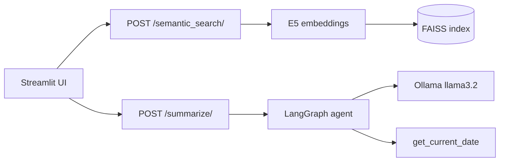

# Product search and summarizer agent

My capstone project for the Amazinum Data Science Camp 2025/2026. It has two parts:

- **Semantic product search:** product descriptions are turned into embeddings with `intfloat/multilingual-e5-large-instruct` and stored in a FAISS index. A search query returns the closest products.
- **Summarizer agent:** a LangGraph agent running on a local Ollama model. It summarizes text, and it can call a `get_current_date` tool when asked for the date.

Both are served by a FastAPI backend and have a Streamlit UI.

## What I wrote and what came from the template

The course authors (Borys Lypa and Viktoria Tsebriy, [Amazinum](https://amazinum.com)) provided the project skeleton: the Streamlit pages, Pydantic models, data loader, sample product data and unit tests. I implemented:

| File | My part |
| :--- | :--- |
| [`src/ds_capstone/vectorizer.py`](./src/ds_capstone/vectorizer.py) | Loading the model and tokenizer, mean pooling with the attention mask, L2 normalization, query prefix |
| [`src/ds_capstone/search_index.py`](./src/ds_capstone/search_index.py) | FAISS `IndexFlatIP` index: build, search, save and load |
| [`src/ds_capstone/summarizer_graph.py`](./src/ds_capstone/summarizer_graph.py) | The date tool, the Ollama model with tools bound, and the LangGraph graph (agent node, tool node, router) |
| [`api.py`](./api.py) | The `/summarize/` and `/semantic_search/` endpoints, `/health`, and building the index on startup |
| [`Dockerfile`](./Dockerfile), [`docker-compose.yml`](./docker-compose.yml) | Running Ollama, the API and the UI together in Docker |

## How it works



Search returns up to 5 products with cosine similarity of at least 0.8. The catalog is small (15 products: phones, smartwatches and dresses in [`data/products.csv`](./data/products.csv)). If the saved index doesn't match the catalog, it's rebuilt on startup.

## Running it

### With Docker

```bash
docker compose up --build
```

This starts Ollama, the API and the UI. The first start downloads the `llama3.2` model and the embedding model (about 2 GB), so it takes a while.

- UI: http://localhost:8501
- API docs: http://localhost:8000/docs

### Without Docker

You need Python 3.12, [Poetry](https://python-poetry.org/docs/#installation) and [Ollama](https://ollama.com/) with the model pulled:

```bash
ollama pull llama3.2
poetry install
poetry run uvicorn api:app --port 8000
```

In a second terminal:

```bash
poetry run streamlit run ui/main_page.py
```

Settings can be changed with environment variables: `LLM_MODEL_NAME` (default `llama3.2`), `OLLAMA_BASE_URL` (default `http://localhost:11434`) and `API_HOST` (default `http://localhost:8000`).

## API

| Endpoint | Body | Returns |
| :--- | :--- | :--- |
| `POST /semantic_search/` | `{"text": "smartwatch with GPS for running"}` | List of products with `rank`, `title`, `brand`, `category`, `description`, `similarity`; 404 if nothing passes the threshold |
| `POST /summarize/` | `{"text": "..."}` | `{"summary": "[summary]: ..."}`, or the current date if the text asks for it |
| `GET /health` | | `{"status": "healthy"}` |

## Tests and linting

```bash
poetry run pytest
poetry run black --check .
poetry run isort --check-only .
poetry run flake8 .
poetry run mypy .
```

One template test, `test_device_selection`, fails: it expects the vectorizer to always use the CPU, while my version uses the GPU when one is available.
