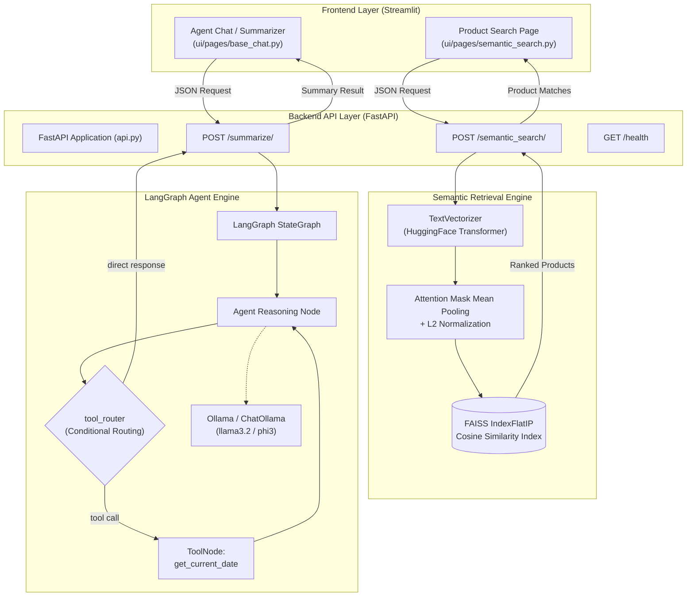

# Semantic Product Discovery & Autonomous Summarization Agent

[](https://www.python.org/)
[](https://fastapi.tiangolo.com)
[](https://github.com/langchain-ai/langgraph)
[](https://github.com/facebookresearch/faiss)
[](https://pytorch.org/)
[](https://streamlit.io)
[](https://python-poetry.org/)
[](https://www.docker.com/)

A production-grade, end-to-end AI application built as the Capstone Project for the **Amazinum Data Science Camp 2025/2026**. 

The system combines **dense semantic vector retrieval** across catalog products with an **autonomous tool-augmented LLM agent** implemented with **LangGraph**, served through an asynchronous **FastAPI** backend and an intuitive **Streamlit** multi-page web UI.

---

## 🏛️ System Architecture



---

## ✨ Key Features

### 1. Dense Semantic Product Retrieval
- **Deep Feature Representation**: Employs Hugging Face transformer models (`intfloat/multilingual-e5-large-instruct`) to generate dense semantic embeddings.
- **Attention-Weighted Mean Pooling**: Correctly handles variable-length sequence masks and prevents division-by-zero errors via clamped token counting.
- **Normalized Vector Matching**: Applies $L_2$ vector normalization so inner-product calculations (`faiss.IndexFlatIP`) precisely compute Cosine Similarity at $O(1)$ lookup speeds.
- **Asymmetric Search Adaptation**: Automatically prepends task-specific retrieval prefixes (`query: `) for asymmetric search compatibility.

### 2. Autonomous Agentic LLM Workflow (LangGraph)
- **Cyclic State Machine**: Built on LangGraph `StateGraph` with typed `AgentState` managing message histories.
- **Tool Calling**: Equips the model with dynamic function calling (`get_current_date` via `@tool`).
- **Conditional Routing**: Automatically inspects model decisions with `tool_router` to route either to `ToolNode` or terminate at `END`.
- **Local LLM Privacy**: Driven by **ChatOllama** (e.g. `llama3.2` or `phi3`), ensuring full local execution without external API dependencies.

### 3. Production FastAPI REST Backend
- **Zero Cold-Start Overhead**: Uses FastAPI lifespan management (`@asynccontextmanager`) to pre-warm the transformer model and load the FAISS index into memory during startup.
- **Strict Data Validation**: Pydantic v2 data models validate and serialize all payload transactions.
- **Interactive OpenAPI Specs**: Built-in Swagger UI (`/docs`) and ReDoc (`/redoc`).

### 4. Interactive Streamlit Interface
- Clean, responsive multi-page dashboard:
  - **Semantic Search**: Natural language query search with similarity scoring and metadata display.
  - **Text Summarizer & Assistant**: Real-time conversation interface powered by the LangGraph agent.

---

## 📁 Project Structure

```
ds_camp_capstone_task/
├── api.py                    # FastAPI server endpoints and lifecycle handlers
├── config.py                 # Centralized configuration (LLM, API, Paths)
├── Dockerfile                # Multi-stage production container definition
├── docker-compose.yml        # Orchestration for API + UI services
├── pyproject.toml            # Poetry dependencies and tool configs
├── poetry.lock               # Deterministic dependency lock
├── Procfile                  # Process definition for Honcho/PaaS
├── src/
│   └── ds_capstone/
│       ├── __init__.py
│       ├── data_loader.py    # Product dataset loading routines
│       ├── models.py         # Pydantic schemas for API requests/responses
│       ├── search_index.py   # FAISS IndexFlatIP management and search
│       ├── summarizer_graph.py # LangGraph agent, tool definitions, state machine
│       └── vectorizer.py     # Transformer model wrapper & mean pooling
├── tests/
│   ├── conftest.py           # Environment and library conflict fixtures
│   ├── test_api.py           # End-to-end API route test suite
│   ├── test_search_index.py  # FAISS index unit tests
│   ├── test_text_summarizer.py # LangGraph summarizer agent tests
│   └── test_text_vectorizer.py # Hugging Face vectorizer unit tests
└── ui/
    ├── main_page.py          # Streamlit landing portal
    └── pages/
        ├── base_chat.py      # Summarization / Agent chat interface
        └── semantic_search.py# Semantic search UI
```

---

## 🚀 Quick Start

### Method 1: Using Docker Compose (Recommended)

Run both the FastAPI backend and Streamlit UI in isolated containers with a single command:

```bash
docker compose up --build
```

- **Streamlit Web UI**: [http://localhost:8501](http://localhost:8501)
- **FastAPI Documentation (Swagger)**: [http://localhost:8000/docs](http://localhost:8000/docs)
- **API Health Endpoint**: [http://localhost:8000/health](http://localhost:8000/health)

---

### Method 2: Local Installation (Poetry)

#### Prerequisites
- Python 3.12+
- [Poetry](https://python-poetry.org/docs/#installation)
- [Ollama](https://ollama.ai/) installed and running locally with model pulled:
  ```bash
  ollama pull llama3.2
  ```

#### 1. Install Dependencies
```bash
poetry install
```

#### 2. Run the FastAPI Backend
```bash
poetry run uvicorn api:app --host 0.0.0.0 --port 8000 --reload
```

#### 3. Run the Streamlit Frontend (in a separate terminal)
```bash
poetry run streamlit run ui/main_page.py
```

---

## 📡 API Reference

### 1. Semantic Product Search
* **Endpoint**: `POST /semantic_search/`
* **Request Body**:
```json
{
  "text": "lightweight waterproof hiking shoes with strong grip"
}
```
* **Response**:
```json
{
  "results": [
    {
      "rank": 1,
      "title": "Trekker Pro Waterproof Trail Shoe",
      "brand": "AlpineGear",
      "category": "Footwear",
      "description": "Breathable Gore-Tex trail shoe with Vibram traction lugs.",
      "similarity": 0.8924
    }
  ]
}
```

### 2. Autonomous Summarizer & Agent
* **Endpoint**: `POST /summarize/`
* **Request Body**:
```json
{
  "text": "What is the current date and what are the main goals of our quarterly sprint?"
}
```
* **Response**:
```json
{
  "summary": "Today is September 25, 2026. [summary]: The team is focused on deploying the semantic search microservice and completing unit testing."
}
```

### 3. Health Check
* **Endpoint**: `GET /health`
* **Response**:
```json
{
  "status": "healthy"
}
```

---

## 🧪 Testing & Code Quality

The project includes unit and integration tests covering the API, vectorizer, FAISS index, and LangGraph agent.

Execute the test suite:
```bash
poetry run pytest
```

Run code formatting and linters:
```bash
poetry run black --check .
poetry run isort --check .
poetry run flake8 .
poetry run mypy src/ds_capstone
```

---

## 👨‍💻 Author

Developed by **Ihor (Quuukie)** as part of the **Amazinum Data Science Camp**.
- GitHub: [@Quuukie](https://github.com/Quuukie)